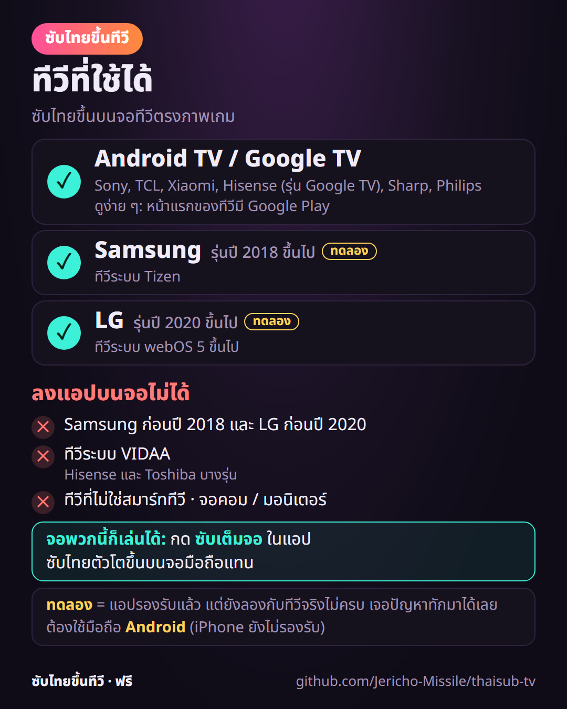

# ซับไทยขึ้นทีวี

แอป Android ที่ใช้กล้องมือถืออ่านซับอังกฤษบนจอทีวี แปลเป็นภาษาไทย แล้วส่งซับไทยขึ้นไปบนทีวี · ใช้ฟรี

**โหลดแอปมือถือ:** [หน้าดาวน์โหลดรุ่นล่าสุด](https://github.com/Jericho-Missile/thaisub-tv/releases/latest) (เลือกไฟล์ .apk)
ลงครั้งเดียวพอ เมื่อมีรุ่นใหม่ แอปจะเด้งบอกให้อัปเดตเอง

**คู่มือมีรูป:** [วิธีลงแอปในมือถือ](phone/install.md) · [วิธีใช้แอป](phone/how-to-use.md)

## ติดตั้งแอปบนทีวี (เลือกยี่ห้อทีวีของคุณ)

| ทีวี | คู่มือ |
|---|---|
| Android TV / Google TV (Sony, TCL, Xiaomi, Hisense, Sharp, Philips) | [คู่มือ Android TV](tv/android-tv.md) |
| Samsung (รุ่นปี 2018 ขึ้นไป) | [คู่มือ Samsung](tv/samsung.md) |
| LG (รุ่นปี 2020 ขึ้นไป) | [คู่มือ LG](tv/lg.md) |

ทีวีรุ่นเก่ากว่านี้, ทีวีระบบ VIDAA, ทีวีที่ไม่ใช่สมาร์ททีวี และจอคอม ลงแอปบนทีวีไม่ได้ แต่ยังเล่นได้ด้วยปุ่ม **ซับเต็มจอ** ในแอป (ซับไทยตัวโตขึ้นบนจอมือถือแทน มีหน้าต่างกล้องเล็ก ๆ ให้เช็กว่ากล้องเล็งตรงซับ)

---

ทำโดย Saksit Phongsri · ห้ามนำไปขายหรือดัดแปลงโดยไม่ได้รับอนุญาต · โปรแกรมนี้ทำมาฟรีเพื่อเพื่อน ๆ ชาวเกมเมอร์
