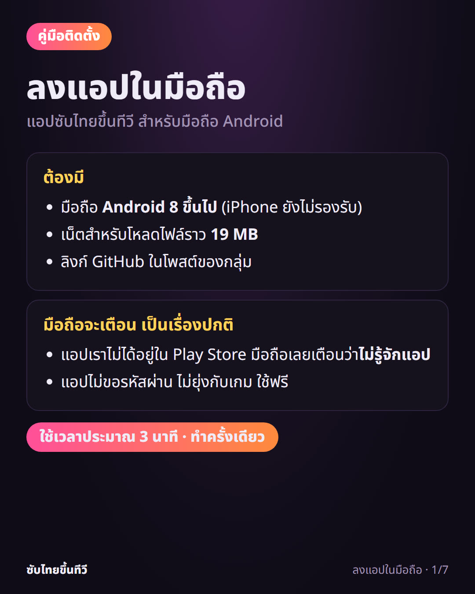
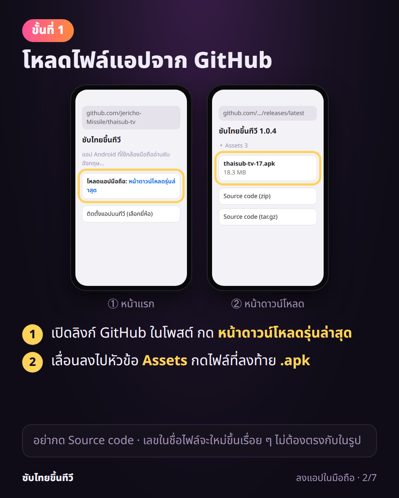
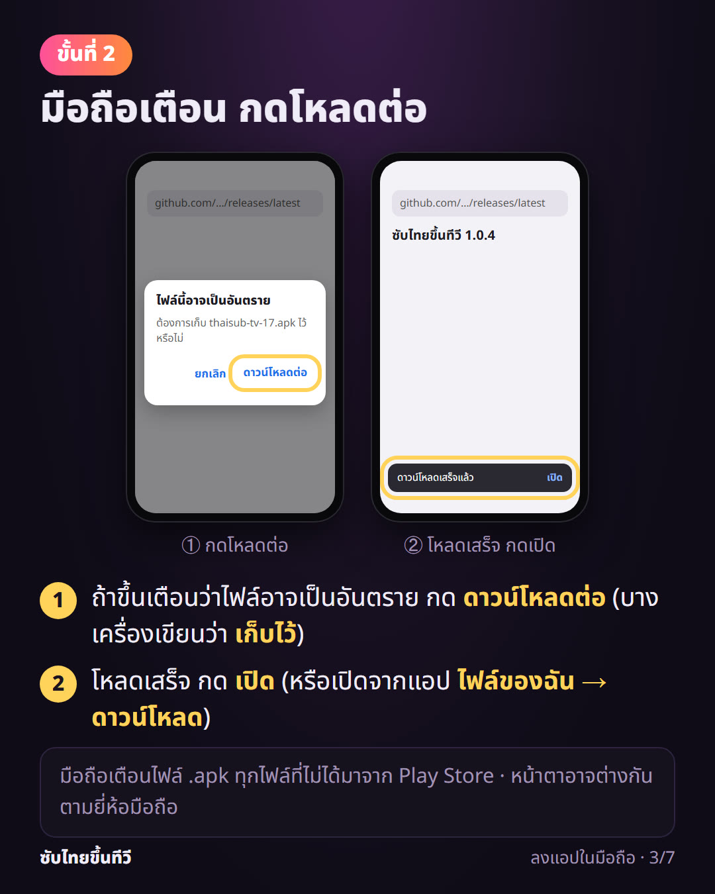
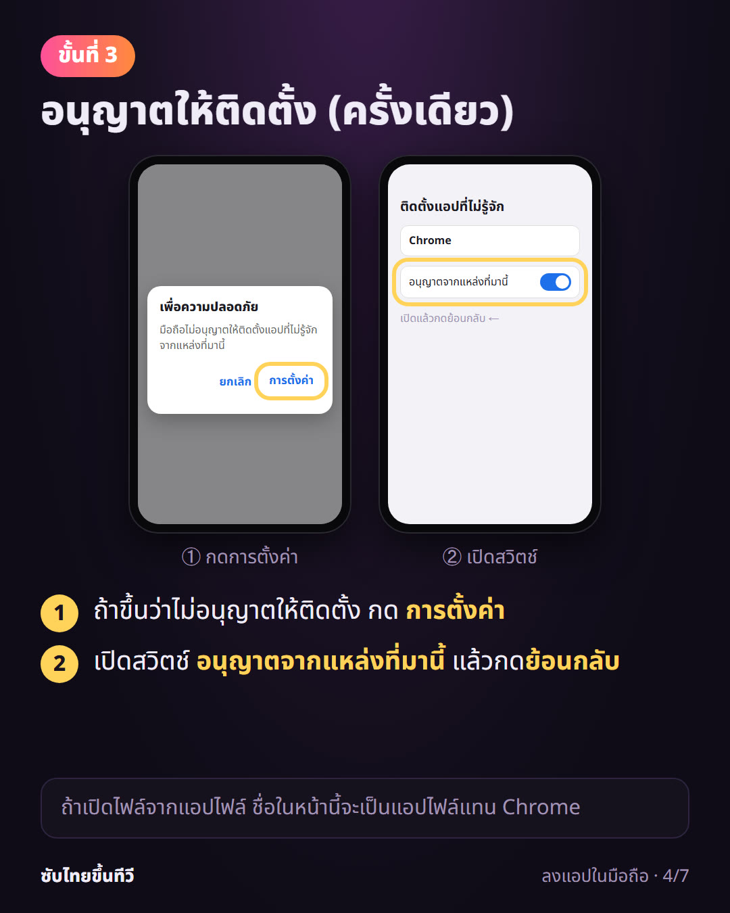
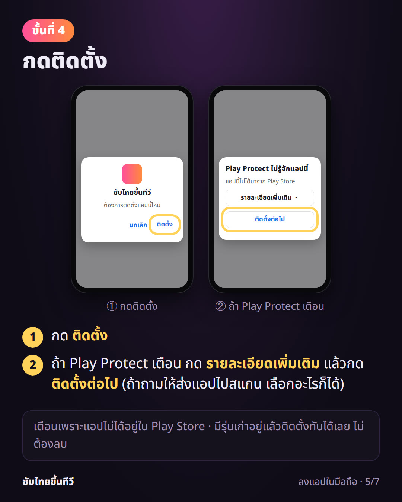
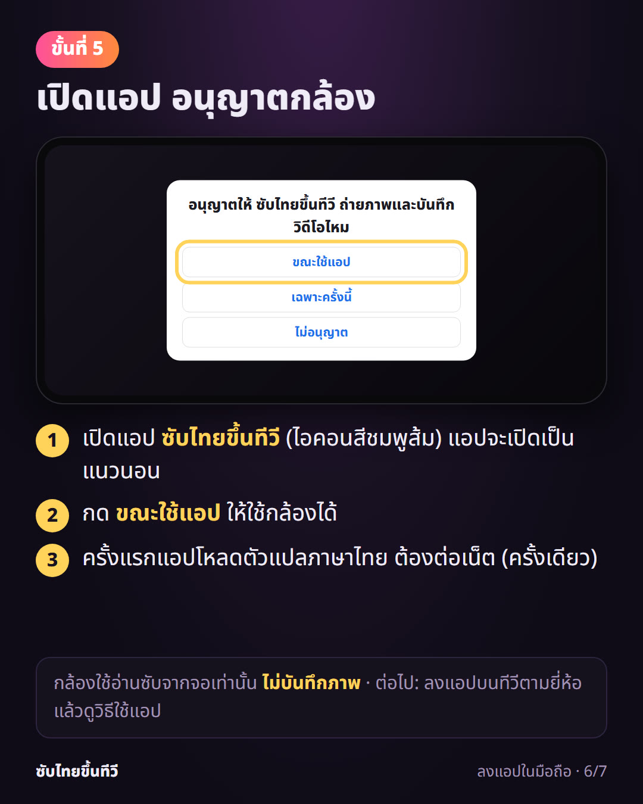
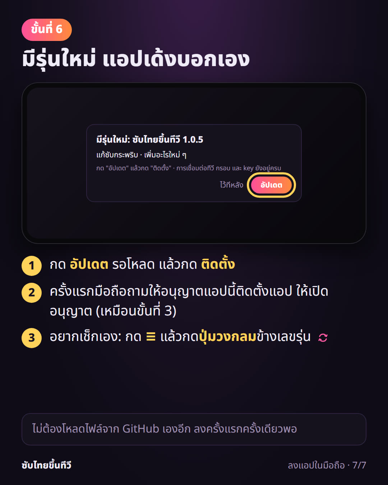

# ลงแอปซับไทยขึ้นทีวีในมือถือ

ใช้กับมือถือ **Android 8 ขึ้นไป** (iPhone ยังไม่รองรับ)
ใช้เวลาประมาณ 3 นาที ทำครั้งเดียว รุ่นต่อ ๆ ไปแอปจะเด้งบอกให้อัปเดตเอง

**ลิงก์โหลดแอป:** [หน้าดาวน์โหลดรุ่นล่าสุด](https://github.com/Jericho-Missile/thaisub-tv/releases/latest) เลือกไฟล์ที่ลงท้าย **.apk**

> มือถือจะเตือนว่าไม่รู้จักแอป เพราะแอปไม่ได้อยู่ใน Play Store เป็นเรื่องปกติ แอปไม่ขอรหัสผ่าน ไม่ยุ่งกับเกม ใช้ฟรี

---

## ขั้นที่ 1: โหลดไฟล์แอปจาก GitHub
1. กดลิงก์ **หน้าดาวน์โหลดรุ่นล่าสุด** ข้างบน
2. เลื่อนลงไปหัวข้อ **Assets** แล้วกดไฟล์ที่ลงท้าย **.apk** (อย่ากด Source code)

## ขั้นที่ 2: มือถือเตือน กดโหลดต่อ
1. ถ้าขึ้นเตือนว่าไฟล์อาจเป็นอันตราย กด **ดาวน์โหลดต่อ** (บางเครื่องเขียนว่า **เก็บไว้**)
2. โหลดเสร็จ กด **เปิด** หรือเปิดจากแอป **ไฟล์ของฉัน → ดาวน์โหลด**

## ขั้นที่ 3: อนุญาตให้ติดตั้ง (ครั้งเดียว)
1. ถ้าขึ้นว่ามือถือไม่อนุญาตให้ติดตั้งแอปจากแหล่งนี้ กด **การตั้งค่า**
2. เปิดสวิตช์ **อนุญาตจากแหล่งที่มานี้** แล้วกด**ย้อนกลับ**

## ขั้นที่ 4: กดติดตั้ง
1. กด **ติดตั้ง**
2. ถ้า Play Protect เตือน กด **รายละเอียดเพิ่มเติม** แล้วกด **ติดตั้งต่อไป** (ถ้าถามให้ส่งแอปไปสแกน เลือกอะไรก็ได้)

มีรุ่นเก่าอยู่แล้ว ติดตั้งทับได้เลย ไม่ต้องลบ

## ขั้นที่ 5: เปิดแอป อนุญาตกล้อง
1. เปิดแอป **ซับไทยขึ้นทีวี** (ไอคอนสีชมพูส้ม) แอปจะเปิดเป็นแนวนอน
2. กด **ขณะใช้แอป** ให้ใช้กล้องได้
3. ครั้งแรกแอปโหลดตัวแปลภาษาไทย ต้องต่อเน็ต (ครั้งเดียว)

กล้องใช้อ่านซับจากจอเท่านั้น ไม่บันทึกภาพ

## ขั้นที่ 6: มีรุ่นใหม่ แอปเด้งบอกเอง
1. กด **อัปเดต** รอโหลด แล้วกด **ติดตั้ง**
2. ครั้งแรกมือถือถามให้อนุญาตแอปนี้ติดตั้งแอป ให้เปิดอนุญาต (เหมือนขั้นที่ 3)
3. อยากเช็กเอง: กด **≡** แล้วกด**ปุ่มวงกลม**ข้างเลขรุ่น

---

**ต่อไป:** ลงแอปบนทีวี [Android TV / Google TV](../tv/android-tv.md) · [Samsung](../tv/samsung.md) · [LG](../tv/lg.md) แล้วดู [วิธีใช้แอป](how-to-use.md)

เจอปัญหาหรือบั๊ก: กด ≡ → **แจ้งบัค** ในแอป หรือโพสต์ถามในกลุ่มพร้อมรูปหน้าจอ
