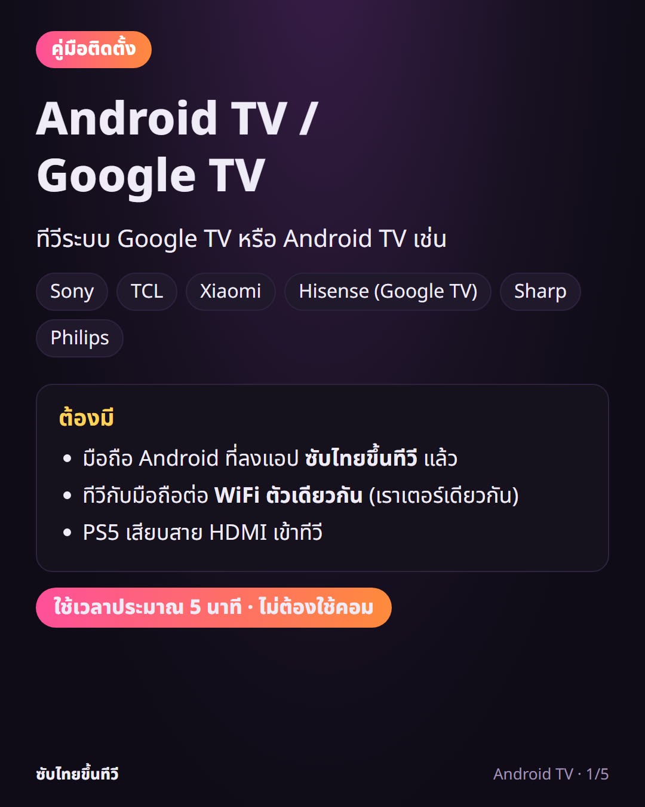
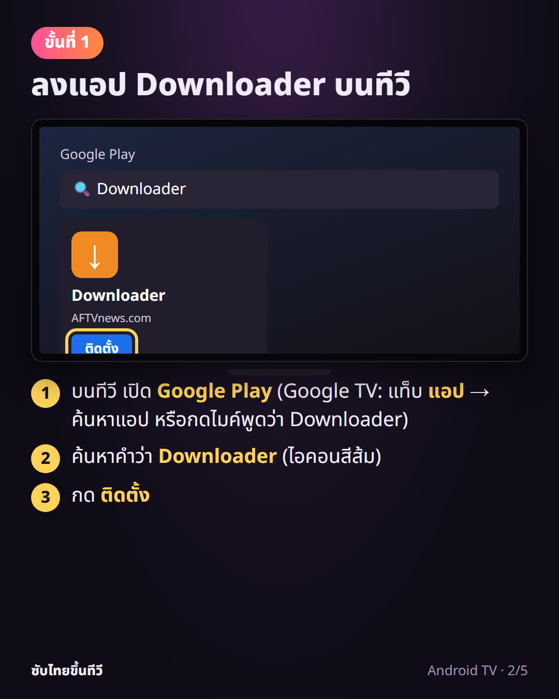
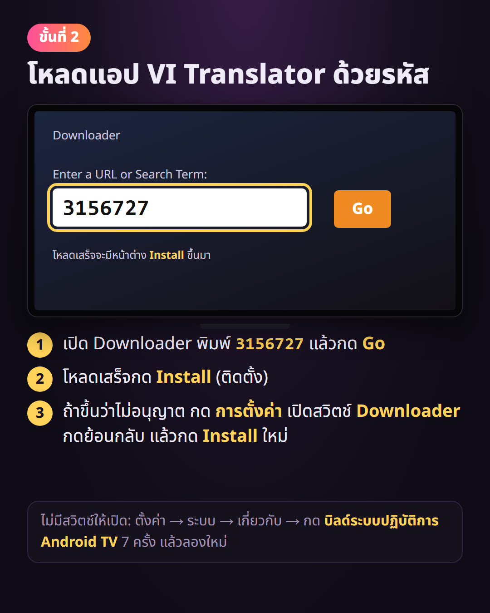
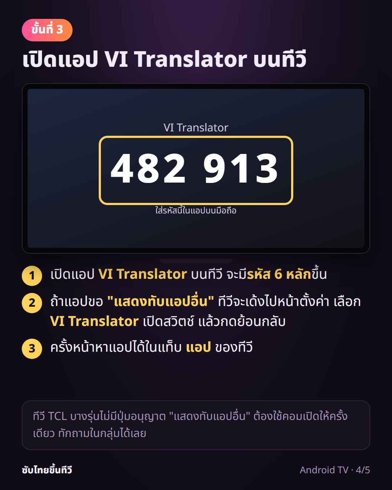
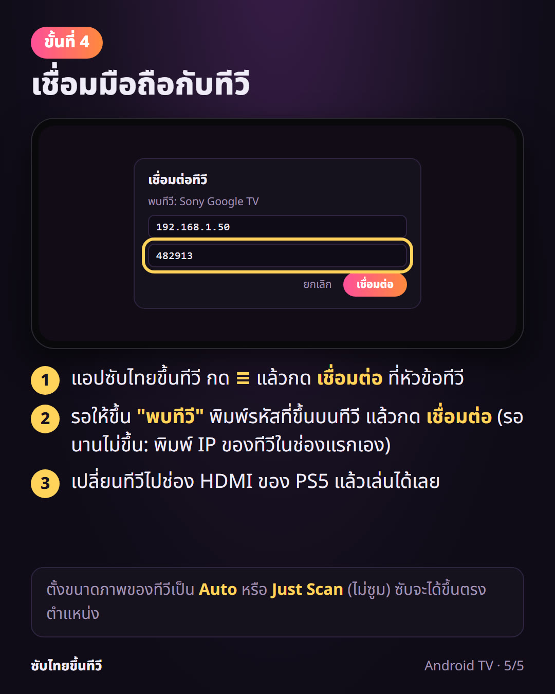

# ติดตั้งบนทีวี Android TV / Google TV

ใช้กับทีวีระบบ **Google TV** หรือ **Android TV** เช่น Sony, TCL, Xiaomi, Hisense (รุ่น Google TV), Sharp และ Philips
ใช้เวลาประมาณ 5 นาที ไม่ต้องใช้คอม

**ต้องมี**
- มือถือ Android ที่ลงแอป **ซับไทยขึ้นทีวี** แล้ว ([โหลดแอปที่นี่](https://github.com/Jericho-Missile/thaisub-tv/releases/latest) · [วิธีลงแบบมีรูป](../phone/install.md))
- ทีวีกับมือถือต่อ **WiFi ตัวเดียวกัน** (เราเตอร์เดียวกัน)
- PS5 เสียบสาย HDMI เข้าทีวี

ทีวียี่ห้ออื่น: [Samsung](samsung.md) · [LG](lg.md)

---

## ขั้นที่ 1: ลงแอป Downloader บนทีวี
บนทีวี เปิด **Google Play** (ทีวี Google TV: ไปแท็บ **แอป** แล้วค้นหาแอป หรือกดปุ่มไมค์แล้วพูดว่า Downloader) ค้นหา **Downloader** (ไอคอนสีส้ม) แล้วกด **ติดตั้ง**

## ขั้นที่ 2: โหลดแอป VI Translator ด้วยรหัส
เปิด Downloader แล้วพิมพ์ **3156727** กด **Go** โหลดเสร็จแล้วกด **Install**
ถ้าขึ้นว่าไม่อนุญาตให้ติดตั้ง กด **การตั้งค่า** เปิดสวิตช์ **Downloader** กดย้อนกลับ แล้วกด **Install** ใหม่
ถ้าไม่มีสวิตช์ให้เปิด: ตั้งค่า → ระบบ → เกี่ยวกับ → กด **บิลด์ระบบปฏิบัติการ Android TV** 7 ครั้ง แล้วลองใหม่

ถ้าวิธีนี้ไม่ได้ ใช้ไฟล์ APK จาก [หน้าดาวน์โหลดของ VI Translator สำหรับ Android TV](https://github.com/vi-translator/vi-translator-android-tv/releases/latest) แทนได้

## ขั้นที่ 3: เปิดแอป VI Translator บนทีวี
เปิดแอป **VI Translator** บนทีวี จะมี **รหัส 6 หลัก** ขึ้น ถ้าแอปขอสิทธิ์ **"แสดงทับแอปอื่น"** ทีวีจะเด้งไปหน้าตั้งค่า เลือก **VI Translator** เปิดสวิตช์ แล้วกดย้อนกลับ · ครั้งหน้าหาแอปได้ในแท็บ **แอป** ของทีวี

ทีวี TCL บางรุ่นไม่มีปุ่มให้อนุญาตสิทธิ์ "แสดงทับแอปอื่น" ต้องใช้คอมเปิดให้ครั้งเดียว ทักถามในกลุ่มได้เลย

## ขั้นที่ 4: เชื่อมมือถือกับทีวี
1. ในแอปซับไทยขึ้นทีวี กด **≡** แล้วกด **เชื่อมต่อ** ที่หัวข้อทีวี
2. รอให้ขึ้นว่า **"พบทีวี"** พิมพ์รหัสที่ขึ้นบนทีวี แล้วกด **เชื่อมต่อ** (รอนานแล้วไม่ขึ้น: พิมพ์เลข IP ของทีวีในช่องแรกเอง ดูได้ในตั้งค่าเครือข่ายของทีวี)
3. เปลี่ยนทีวีไปช่อง HDMI ของ PS5 แล้วเล่นได้เลย

ตั้งขนาดภาพของทีวีเป็น **Auto** หรือ **Just Scan** (ไม่ซูม) ซับจะได้ขึ้นตรงตำแหน่ง

---

แอปบนทีวีเป็นของโปรเจกต์ [VI Translator](https://github.com/vi-translator) (โอเพนซอร์ส MIT) · คู่มือนี้ทำโดยกลุ่มซับไทยขึ้นทีวี
