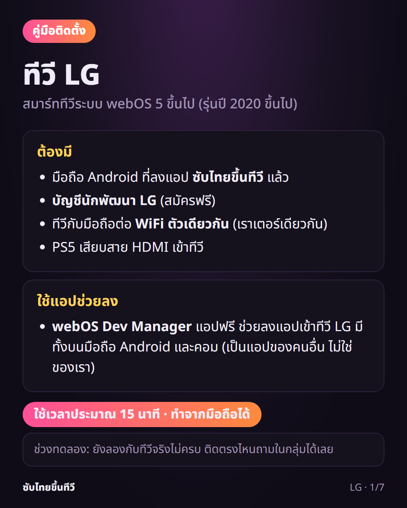
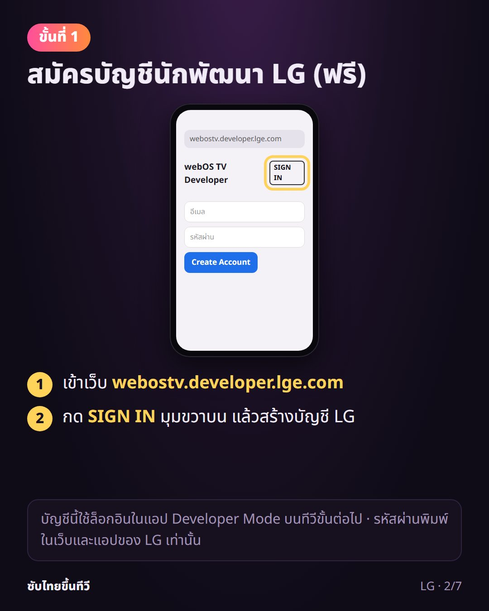
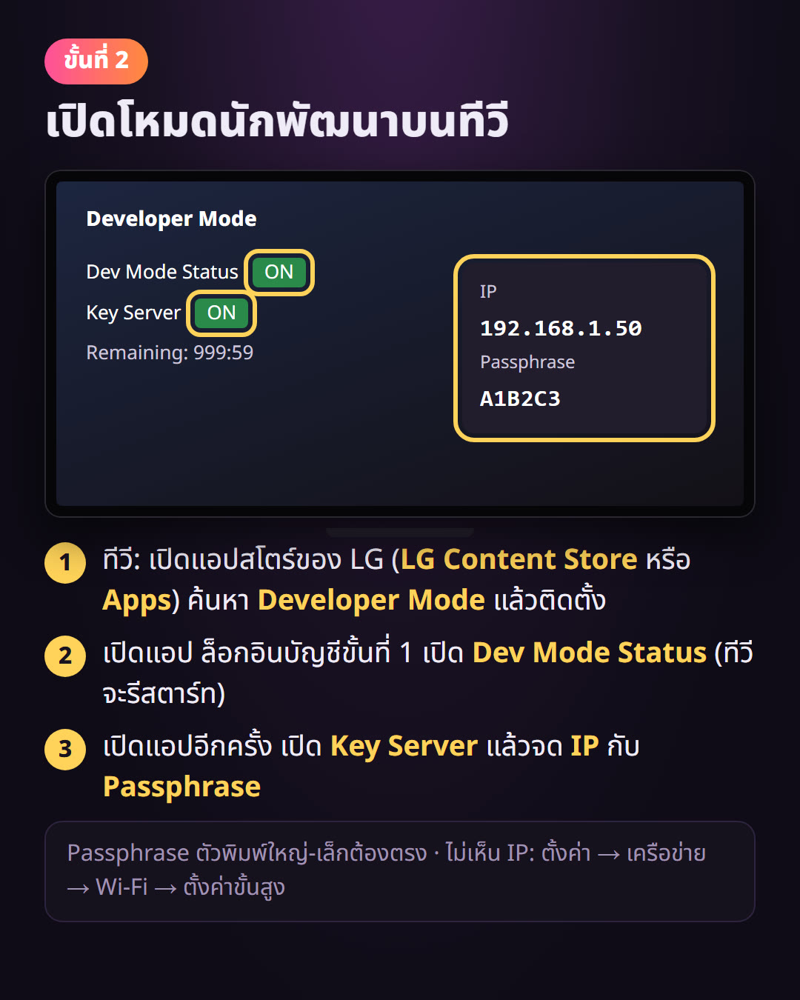
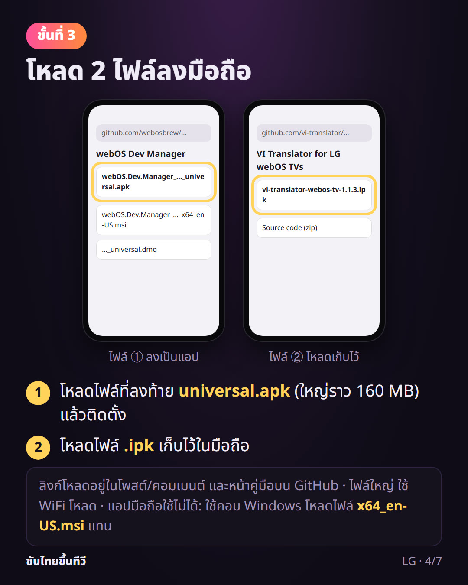
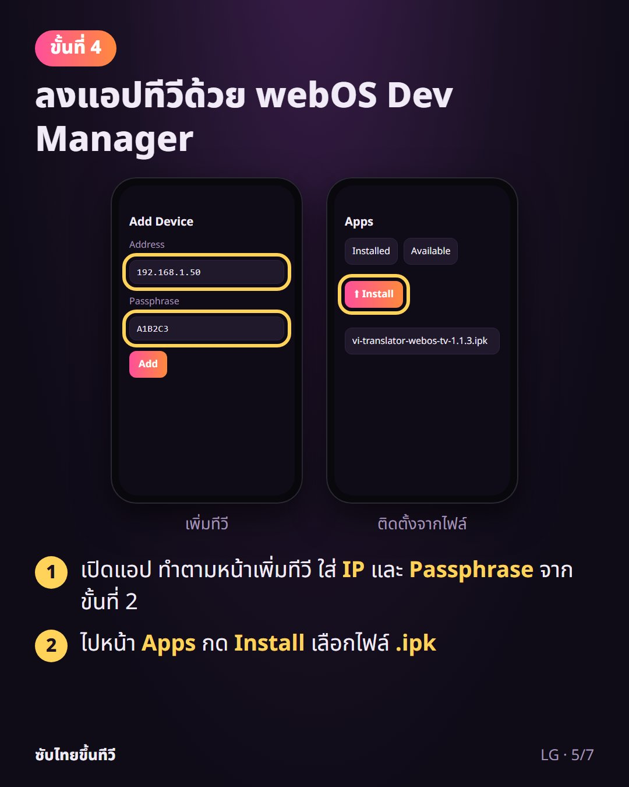
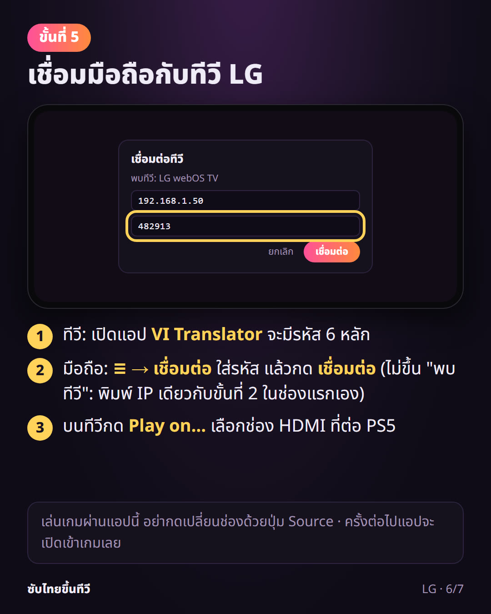
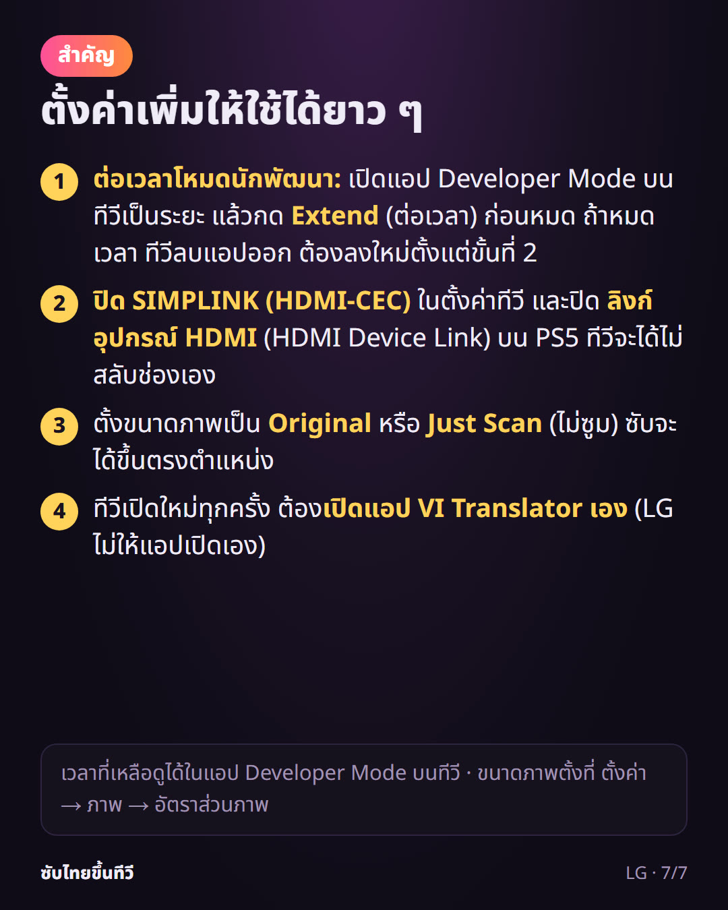

# ติดตั้งบนทีวี LG

ใช้กับสมาร์ททีวี LG ระบบ **webOS 5 ขึ้นไป (รุ่นปี 2020 ขึ้นไป)**
ใช้เวลาประมาณ 15 นาที ไม่ต้องใช้คอม ทำจากมือถือ Android ได้เลย (หรือใช้คอม Windows ก็ได้)

> **ยังอยู่ช่วงทดลอง:** แอปซับไทยขึ้นทีวีเชื่อมต่อแบบเดียวกับที่แอป LG ต้องการ แต่ยังไม่มีคนในกลุ่มลองกับทีวี LG จริงครบทุกขั้น ถ้าติดขั้นไหน โพสต์ถามในกลุ่มพร้อมรูปหน้าจอได้เลย

**ต้องมี**
- มือถือ Android ที่ลงแอป **ซับไทยขึ้นทีวี** แล้ว ([โหลดแอปที่นี่](https://github.com/Jericho-Missile/thaisub-tv/releases/latest) · [วิธีลงแบบมีรูป](../phone/install.md))
- **บัญชีนักพัฒนา LG** (สมัครฟรีที่ [webostv.developer.lge.com](https://webostv.developer.lge.com))
- ทีวีกับมือถือต่อ **WiFi ตัวเดียวกัน** (เราเตอร์เดียวกัน)
- PS5 เสียบสาย HDMI เข้าทีวี

**ไฟล์ที่ต้องโหลด**
1. แอป **webOS Dev Manager**: [หน้าดาวน์โหลด](https://github.com/webosbrew/dev-manager-desktop/releases/latest)
   - มือถือ: เลือกไฟล์ที่ลงท้าย **universal.apk** (ไฟล์ใหญ่ราว 160 MB)
   - คอม Windows: เลือกไฟล์ที่ลงท้าย **x64_en-US.msi** (ถ้าแอปบนมือถือใช้ไม่ได้ ใช้คอมแทน)
   - เป็นแอปฟรีของคนอื่น ช่วยลงแอปเข้าทีวี LG
2. แอปทีวี **VI Translator สำหรับ LG**: [หน้าดาวน์โหลด](https://github.com/vi-translator/vi-translator-webos-tv/releases/latest) เลือกไฟล์ที่ลงท้าย **.ipk**

ทีวียี่ห้ออื่น: [Android TV / Google TV](android-tv.md) · [Samsung](samsung.md)

---

## ขั้นที่ 1: สมัครบัญชีนักพัฒนา LG (ฟรี)
เข้าเว็บ **webostv.developer.lge.com** กด **SIGN IN** ที่มุมขวาบน แล้วสร้างบัญชี LG

## ขั้นที่ 2: เปิดโหมดนักพัฒนาบนทีวี
1. ทีวี: เปิดแอปสโตร์ของ LG (ชื่อ **LG Content Store** หรือ **Apps**) ค้นหา **Developer Mode** แล้วติดตั้ง
2. เปิดแอป แล้วล็อกอินด้วยบัญชีจากขั้นที่ 1 จากนั้นเปิด **Dev Mode Status** (ทีวีจะรีสตาร์ท)
3. เปิดแอป Developer Mode อีกครั้ง เปิด **Key Server** แล้วจด **IP** และ **Passphrase** ที่ขึ้นบนจอไว้ (Passphrase ตัวพิมพ์ใหญ่-เล็กต้องตรง · ไม่เห็น IP: ตั้งค่า → เครือข่าย → Wi-Fi → ตั้งค่าขั้นสูง)

## ขั้นที่ 3: โหลด 2 ไฟล์ลงมือถือ
- โหลดไฟล์ที่ลงท้าย **universal.apk** แล้วติดตั้ง (ไฟล์ใหญ่ ใช้ WiFi โหลด · วิธีลงไฟล์ .apk ทำแบบเดียวกับ[คู่มือลงแอปในมือถือ](../phone/install.md))
- โหลดไฟล์ **.ipk** เก็บไว้ในมือถือ

## ขั้นที่ 4: ลงแอปทีวีด้วย webOS Dev Manager
1. เปิดแอป ทำตามหน้าเพิ่มทีวี (Add Device) ใส่ **IP** และ **Passphrase** จากขั้นที่ 2
2. ไปที่หน้า **Apps** กด **Install** แล้วเลือกไฟล์ **.ipk**

## ขั้นที่ 5: เชื่อมมือถือกับทีวี LG
1. ทีวี: เปิดแอป **VI Translator** จะมีรหัส 6 หลักขึ้น
2. มือถือ: กด **≡** แล้วกด **เชื่อมต่อ** ใส่รหัส แล้วกด **เชื่อมต่อ** (ไม่ขึ้น "พบทีวี": พิมพ์ IP ของทีวี เลขเดียวกับขั้นที่ 2 ในช่องแรกเอง)
3. บนทีวีกด **Play on…** แล้วเลือกช่อง HDMI ที่ต่อ PS5

ตอนเล่นเกมให้เล่นผ่านแอปนี้ อย่ากดเปลี่ยนช่องด้วยปุ่ม Source ครั้งต่อไปแอปจะเปิดเข้าเกมให้เลย

## สำคัญ: ตั้งค่าเพิ่มเพื่อให้ใช้ได้ยาว ๆ
1. **ต่อเวลาโหมดนักพัฒนา:** เปิดแอป Developer Mode บนทีวีเป็นระยะ แล้วกด **Extend** ก่อนเวลาหมด ถ้าหมดเวลา ทีวีจะลบแอปออก ต้องเปิดโหมดนักพัฒนาและลงแอปใหม่ตั้งแต่ขั้นที่ 2 · ดูเวลาที่เหลือได้ในแอป Developer Mode
2. **ปิด SIMPLINK (HDMI-CEC)** ในตั้งค่าทีวี และปิด **ลิงก์อุปกรณ์ HDMI** (HDMI Device Link) บน PS5 ทีวีจะได้ไม่สลับช่องเอง
3. ตั้งขนาดภาพเป็น **Original** หรือ **Just Scan** (ไม่ซูม ตั้งที่ ตั้งค่า → ภาพ → อัตราส่วนภาพ) ซับจะได้ขึ้นตรงตำแหน่ง
4. ทุกครั้งที่เปิดทีวีใหม่ ต้อง**เปิดแอป VI Translator เอง** เพราะ LG ไม่ให้แอปเปิดขึ้นมาเอง

---

แอปบนทีวีเป็นของโปรเจกต์ [VI Translator](https://github.com/vi-translator) (โอเพนซอร์ส MIT) · webOS Dev Manager เป็นแอปของ [webOS Homebrew](https://github.com/webosbrew/dev-manager-desktop) · คู่มือนี้ทำโดยกลุ่มซับไทยขึ้นทีวี
