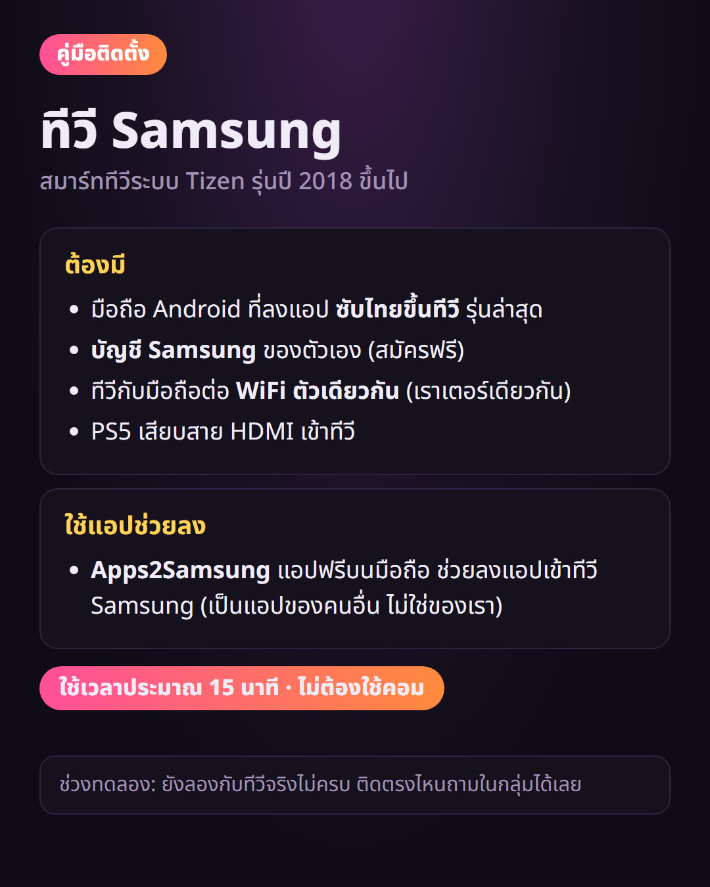
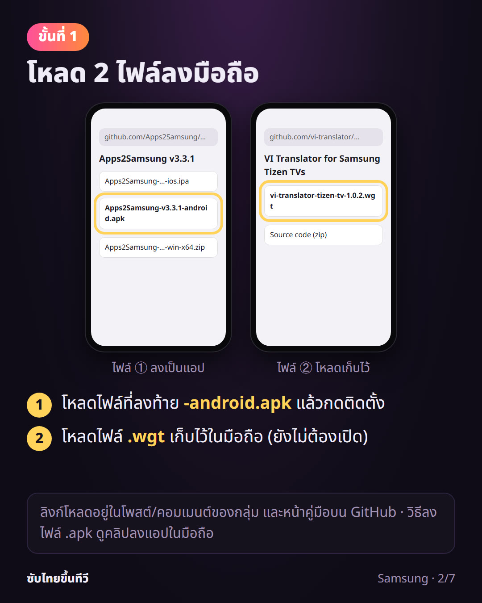
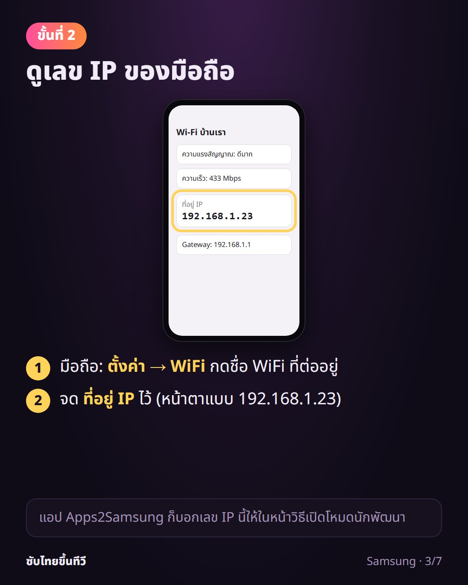
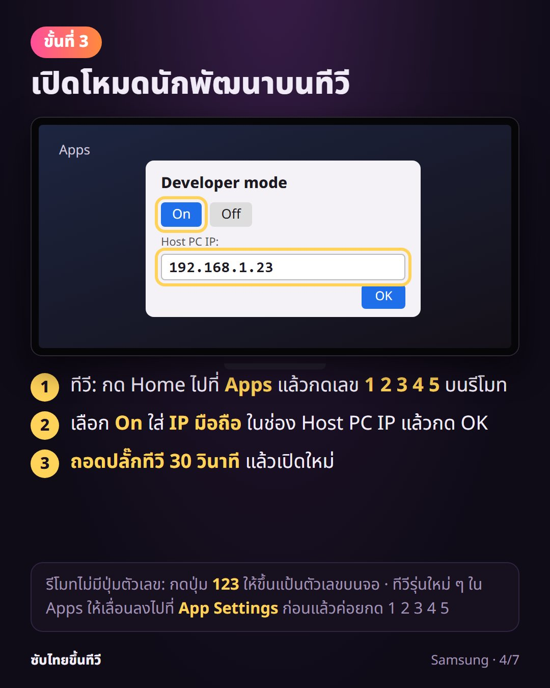
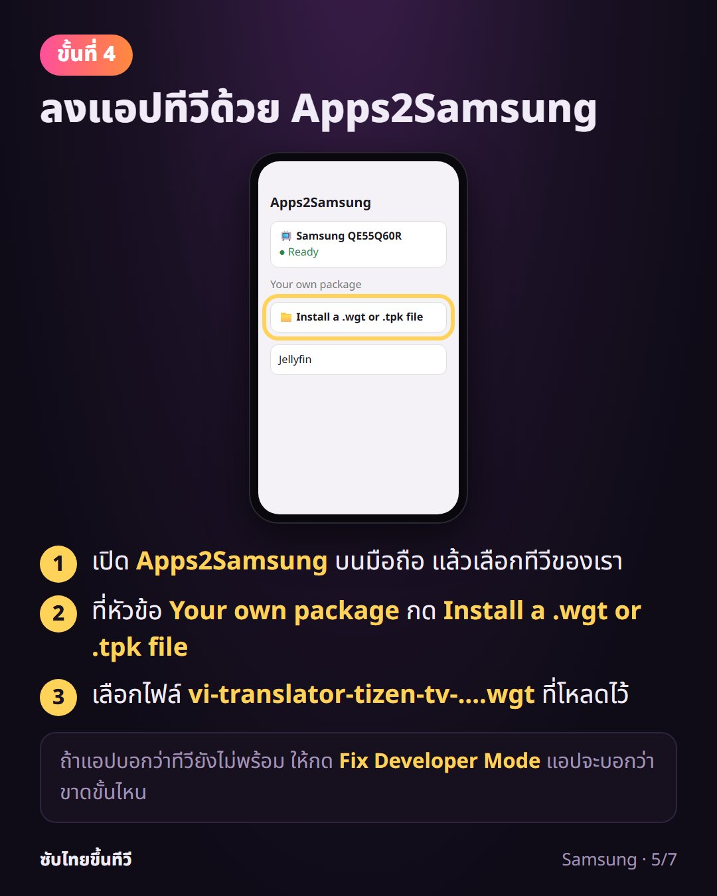
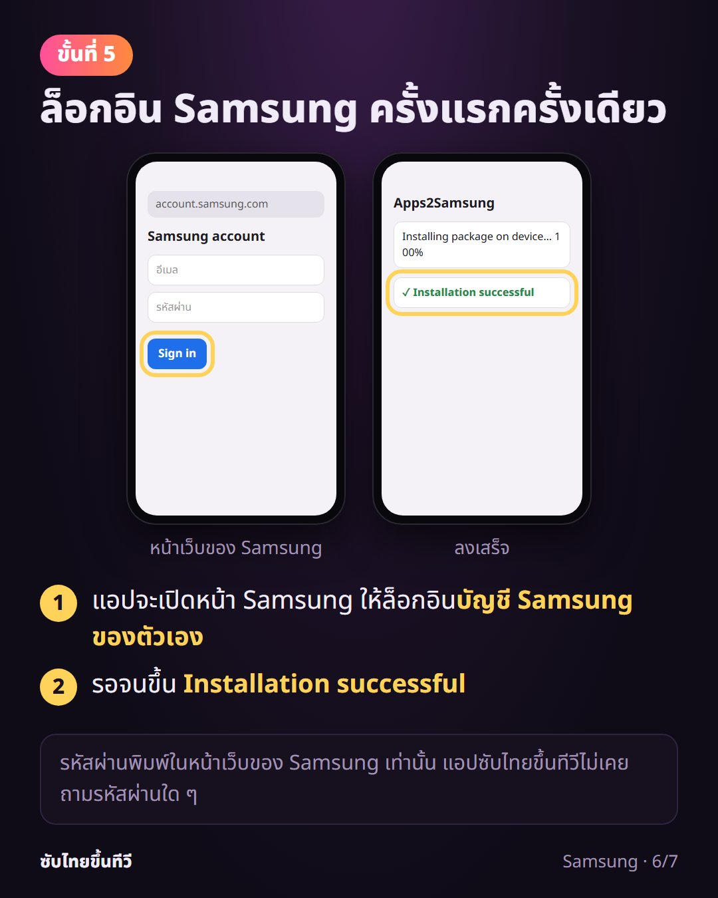
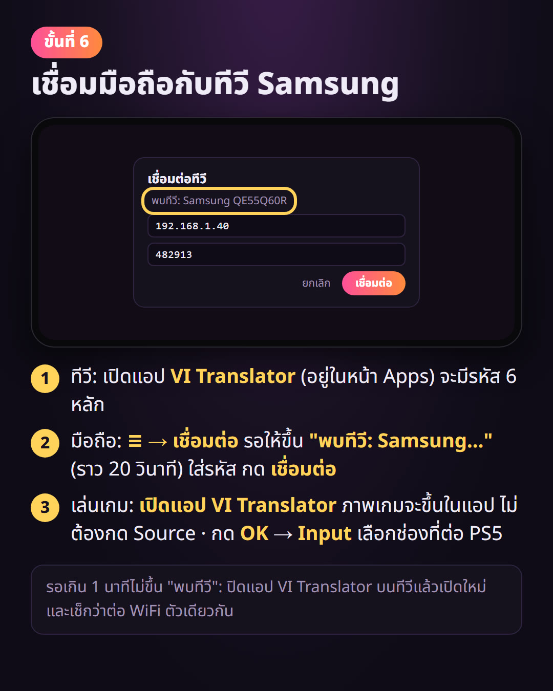

# ติดตั้งบนทีวี Samsung

ใช้กับสมาร์ททีวี Samsung ระบบ **Tizen รุ่นปี 2018 ขึ้นไป**
ใช้เวลาประมาณ 15 นาที ไม่ต้องใช้คอม ทำจากมือถือ Android ได้เลย

> **ยังอยู่ช่วงทดลอง:** แอปซับไทยขึ้นทีวีเพิ่งรองรับ Samsung ในรุ่น 1.0.2 และยังไม่มีคนในกลุ่มลองกับทีวีจริงครบทุกขั้น ถ้าติดขั้นไหน โพสต์ถามในกลุ่มพร้อมรูปหน้าจอได้เลย

**ต้องมี**
- มือถือ Android ที่ลงแอป **ซับไทยขึ้นทีวี** รุ่นล่าสุด ([โหลดแอปที่นี่](https://github.com/Jericho-Missile/thaisub-tv/releases/latest) · [วิธีลงแบบมีรูป](../phone/install.md))
- **บัญชี Samsung** ของตัวเอง ([สมัครฟรี](https://account.samsung.com))
- ทีวีกับมือถือต่อ **WiFi ตัวเดียวกัน** (เราเตอร์เดียวกัน)
- PS5 เสียบสาย HDMI เข้าทีวี

**ไฟล์ที่ต้องโหลด**
1. แอป **Apps2Samsung** สำหรับมือถือ: [หน้าดาวน์โหลด](https://github.com/Apps2Samsung/Apps2Samsung/releases/latest) เลือกไฟล์ที่ลงท้าย **-android.apk** (เป็นแอปฟรีของคนอื่น ช่วยลงแอปเข้าทีวี Samsung)
2. แอปทีวี **VI Translator สำหรับ Samsung**: [หน้าดาวน์โหลด](https://github.com/vi-translator/vi-translator-tizen-tv/releases/latest) เลือกไฟล์ที่ลงท้าย **.wgt**

ทีวียี่ห้ออื่น: [Android TV / Google TV](android-tv.md) · [LG](lg.md)

---

## ขั้นที่ 1: โหลด 2 ไฟล์ลงมือถือ
- โหลดไฟล์ที่ลงท้าย **-android.apk** แล้วกดติดตั้ง (วิธีลงไฟล์ .apk ทำแบบเดียวกับ[ขั้นที่ 2-4 ของคู่มือลงแอปในมือถือ](../phone/install.md))
- โหลดไฟล์ **.wgt** เก็บไว้ในมือถือ ยังไม่ต้องเปิด

## ขั้นที่ 2: ดูเลข IP ของมือถือ
มือถือ: **ตั้งค่า → WiFi** แล้วกดชื่อ WiFi ที่ต่ออยู่ (มือถือ Samsung: กดรูปเฟือง ⚙ ข้างชื่อ WiFi) จด **ที่อยู่ IP** ไว้ (หน้าตาแบบ 192.168.1.23) · แอป Apps2Samsung ก็บอกเลข IP นี้ให้

## ขั้นที่ 3: เปิดโหมดนักพัฒนาบนทีวี
1. ทีวี: กด Home แล้วไปที่ **Apps** จากนั้นกดเลข **1 2 3 4 5** บนรีโมท
   - ถ้ารีโมทไม่มีปุ่มตัวเลข ให้กดปุ่ม **123** เพื่อให้แป้นตัวเลขขึ้นบนจอ
   - ทีวีรุ่นใหม่ ๆ ให้เลื่อนลงไปที่ **App Settings** ในหน้า Apps ก่อน แล้วค่อยกด 1 2 3 4 5
2. เลือก **On** ใส่ **IP มือถือ** ในช่อง **Host PC IP** แล้วกด OK
3. **ถอดปลั๊กทีวี 30 วินาที** แล้วเปิดใหม่ (การกดปิดด้วยรีโมทไม่นับ)

## ขั้นที่ 4: ลงแอปทีวีด้วย Apps2Samsung
1. เปิด **Apps2Samsung** บนมือถือ แล้วกดชื่อทีวีของเราที่ขึ้นในแอป (แอปเป็นภาษาอังกฤษ)
2. ที่หัวข้อ **Your own package** กด **Install a .wgt or .tpk file**
3. เลือกไฟล์ **vi-translator-tizen-tv-….wgt** ที่โหลดไว้

ถ้าแอปบอกว่าทีวียังไม่พร้อม ให้กด **Fix Developer Mode** แอปจะบอกว่ายังขาดขั้นไหน

## ขั้นที่ 5: ล็อกอิน Samsung ครั้งแรก ครั้งเดียว
แอปจะเปิดหน้าเว็บของ Samsung ให้ล็อกอิน**บัญชี Samsung ของตัวเอง** เพื่อทำใบรับรองสำหรับลงแอป จากนั้นรอจนขึ้น **Installation successful**

รหัสผ่านให้พิมพ์ในหน้าเว็บของ Samsung เท่านั้น แอปซับไทยขึ้นทีวีไม่เคยถามรหัสผ่านใด ๆ

## ขั้นที่ 6: เชื่อมมือถือกับทีวี Samsung
1. ทีวี: เปิดแอป **VI Translator** (อยู่ในหน้า Apps) จะมีรหัส 6 หลักขึ้น
2. มือถือ: กด **≡** แล้วกด **เชื่อมต่อ** รอให้ขึ้นว่า **"พบทีวี: Samsung…"** (ใช้เวลาราว 20 วินาที) จากนั้นใส่รหัส แล้วกด **เชื่อมต่อ**
3. ตอนเล่นเกม: **เปิดแอป VI Translator** แทนการเปลี่ยนไปช่อง HDMI (ภาพเกมจะขึ้นในแอป ไม่ต้องกด Source) กด **OK** แล้วเลือก **Input** เป็นช่องที่ต่อ PS5

---

แอปบนทีวีเป็นของโปรเจกต์ [VI Translator](https://github.com/vi-translator) (โอเพนซอร์ส MIT) · Apps2Samsung เป็นแอปของ [Apps2Samsung](https://github.com/Apps2Samsung/Apps2Samsung) · คู่มือนี้ทำโดยกลุ่มซับไทยขึ้นทีวี
